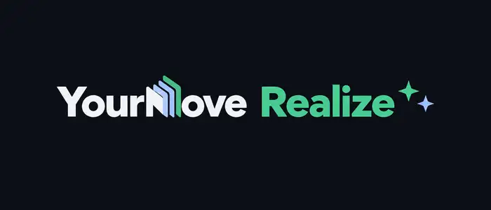
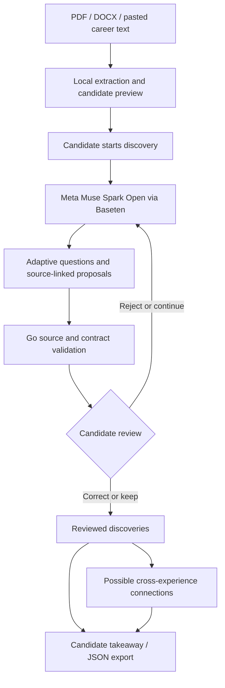

<p align="center">
  
</p>

<h1 align="center">You've done more than your résumé shows.</h1>

<p align="center">
  AI-guided career discovery that helps people recognize the judgment, initiative, and strengths hidden in work they've already done.
</p>

<p align="center"><strong>Rediscover your strengths. Recognize your worth. Realize what's possible.</strong></p>

<p align="center">
  <a href="https://realize.yourmove.run/">Try the live demo</a> ·
  <a href="#judge-walkthrough">Judge walkthrough</a> ·
  <a href="#run-it-locally">Run it locally</a>
</p>

<p align="center"><sub>Meta Global AI Developer Hackathon 2026 · Indie Developer · Build for Your World</sub></p>

---

## Judge walkthrough

**Try the [live demo](https://realize.yourmove.run/).** No account is required. You can paste a short description of an experience or download and upload the fictional [Avery Morgan résumé (PDF)](realize-demo-pack/fixtures/avery-morgan-resume.pdf) ([DOCX](realize-demo-pack/fixtures/avery-morgan-resume.docx)).

1. **Explore:** Review the source material, select an experience, and answer the interviewer's follow-up questions.
2. **Inspect:** When Realize suggests a possible discovery, examine the verbatim quotes behind it and what remains unconfirmed.
3. **Decide:** Correct, keep, or reject the interpretation. Explore another experience to see possible connections, then review or export the takeaway.

The experience is designed to surface possibilities for **candidate review**, not to verify employment claims or assign a score.

## The problem isn't always a missing qualification

A résumé can tell someone where you worked and what your job was called. It's much less effective at capturing the decisions you made when something went wrong, the people you helped, or the improvements you quietly introduced.

And when you're looking for work, it's surprisingly easy to overlook the value of your own experience.

Most AI résumé tools start with *How can we rewrite this?* **YourMove Realize starts earlier: *What did you actually do that you haven't recognized yet?***

Realize is an interactive interview, not a résumé score or automatic career verdict. It asks about a specific experience, listens to the answer, follows the details, and offers a possible discovery that the person can examine, correct, or reject.

## See what a conversation can uncover

*Fictional illustration from the app's landing page. This is not a recorded candidate result or a claim of measured impact.*

| A résumé might say | A conversation can reveal |
| --- | --- |
| "Handled incoming requests and administrative tasks." | "I put together a checklist, reviewed it with my manager, and we started using it for handoffs." |

Realize might recognize a possibility: **this person didn't just process requests; they noticed a recurring problem and collaborated on a practical improvement.**

The key isn't to turn that into an inflated leadership claim. It's to ask *what happened, who did what, and what remains unknown*, then let the candidate decide whether the interpretation fits.

**The candidate's words are evidence for an interpretation. They are not independent proof of that interpretation.**

## Why I built it

I've spent years in technical support and systems work, where the most valuable part of a day is often the least visible on a résumé: diagnosing a strange failure, making a judgment call, following through with a customer, or noticing a pattern before it becomes a bigger problem.

During my own job search, I kept coming back to the gap between doing meaningful work and knowing how to describe its value.

I wanted to explore whether AI could help people *recognize* their experience before trying to optimize the way they present it. Something that restores agency instead of manufacturing confidence with compliments.

That question became Realize.

## Built for this hackathon, separate from YourMove

**YourMove Realize was designed and built during the Meta Global AI Developer Hackathon (October 26–November 4, 2026).** The standalone application and its career-discovery engine are hackathon work.

It is **not** my preexisting open-source [YourMove job-application tool](https://github.com/jenksed/yourmove-go). That project helps people prepare and work through job applications while retaining control over submission. Realize is a different application, in its own repository, with its own runtime and a different purpose: helping someone uncover the value of their experience through conversation.

They share a belief that AI should assist people's judgment rather than replace it. **Building Realize did not require copying or running the existing job-application app.** Historical integration experiments are retained under [integration/](integration/README.md) for context; they are not needed to run or judge this standalone demo.

The discovery engine is included at the root of this public repository. Its `go.mod` retains the original development module path `github.com/jenksed/yourmove-career-discovery`; Go resolves those imports to the local source. No access to the separate development repository is required to build or run the demo.

## How Realize works

1. **Start with what you have.** Upload a text-based PDF/DOCX résumé or paste a role, project, or experience. Review the extracted text before any inference request.
2. **Explore one experience.** Meta Muse Spark asks focused follow-up questions about personal actions, choices, collaboration, follow-through, and what the person does or does not know. Spoken questions and voice responses are optional.
3. **Recognize a possibility.** Realize presents a potential discovery alongside exact cited statements and open questions. The candidate can inspect its reasoning, correct the wording, keep talking, or reject it.
4. **See the larger picture.** Keep reviewed discoveries, examine possible common threads across experiences, and leave with a takeaway that distinguishes supported statements from possibilities worth exploring.

Nothing is automatically added to an employer application. Realize does not submit jobs, certify skills, or independently verify a person's account.

## Why Meta Muse Spark matters here

The model does substantive work throughout the experience. It isn't a one-shot résumé rewrite behind a polished interface.

- **Adaptive interviewing:** Muse uses the selected experience and full recorded answers to choose its next question, rather than running a static questionnaire.
- **Structured recognition:** Muse proposes concise interpretations, anchored to identified candidate responses, while explicitly retaining unknown outcomes and responsibilities.
- **Cross-experience synthesis:** After a person reviews separate discoveries, Muse can suggest connections between them without treating those connections as established facts.
- **Outcome selection:** Muse selects possible résumé uses and transferable strengths. The application constrains how those suggestions are presented.

The standalone Go service calls **Meta Muse Spark Open through Baseten**. Optional speech uses **Deepgram** for transcription and **Fish Audio** for spoken questions; those are separate services, not Meta models.

### The boundary between generation and acceptance

The Go engine checks structured output, response identifiers, and verbatim source quotations. Invalid source references are rejected, and a model's previous proposal is not allowed to become its own evidence. Candidate corrections remain distinguishable from the model's suggestions.

Those checks can prove that a quote came from a recorded answer. They **cannot** prove the candidate's report is true or that the model's interpretation is semantically justified. That is why the product makes review and correction part of the experience, rather than treating a plausible AI answer as approved evidence.

## Architecture



The application is a standalone Go web service with an in-memory session model and a server-rendered interface. The discovery engine and its validation logic live in the same repository, not in a hosted black box.

| Inspect | What it does |
| --- | --- |
| [discovery.go](discovery.go) | Interview state, recorded responses, proposal validation, bounded questioning |
| [connections.go](connections.go) | Source-aware synthesis across reviewed discoveries |
| [outcomes.go](outcomes.go) | Constrained takeaway suggestions based on reviewed evidence |
| [cmd/realize-demo/main.go](cmd/realize-demo/main.go) | HTTP workflow, session state, review, upload handling, Baseten transport |
| [cmd/realize-demo/page.go](cmd/realize-demo/page.go) | Actual browser experience |
| [cmd/realize-demo/speech.go](cmd/realize-demo/speech.go) | Optional speech integrations and failure handling |

## Run it locally

Requires **Go 1.27.2+** and Poppler's `pdftotext` command on your `PATH`. On macOS, install Poppler with `brew install poppler`.

```bash
git clone https://github.com/jenksed/yourmove-realize-demo.git
cd yourmove-realize-demo
```

Create a local `.env` file with a Baseten API key authorized for the configured model:

```dotenv
BASETEN_API_KEY=your-key-here
BASETEN_MODEL=meta-models/muse-spark-open-1026
```

The model identifier above is the restricted hackathon model used in development. Use an accessible Muse Spark Open model identifier for your own Baseten account if needed. The service does not silently switch providers or models.

```bash
go test -count=1 ./...
go run ./cmd/realize-demo
```

Open **http://localhost:8080**. To exercise both upload paths, try the fictional [Avery Morgan PDF](realize-demo-pack/fixtures/avery-morgan-resume.pdf) or [DOCX](realize-demo-pack/fixtures/avery-morgan-resume.docx). You can also paste a short description of your own work.

Deepgram and Fish Audio keys are optional for a text-only experience. See [full setup and operational notes](docs/LOCAL_SETUP.md) for speech configuration, quotas, provider access, and additional details.

## Privacy, limits, and what this demo does not claim

- The user sees extracted text and a disclosure before sending career material or responses to Baseten for inference. Original uploaded files are not kept as permanent uploads.
- Session state lives in server memory and is lost on server restart; a reviewed takeaway can be downloaded as JSON. The app currently has no accounts or durable server-side candidate history.
- Optional audio transcription sends a recording to Deepgram; optional spoken-question generation sends question text to Fish Audio. Consult each provider's own data-handling policies. This README makes no blanket zero-retention claim across providers.
- PDF and DOCX inputs are capped at 10 MiB; the engine considers up to 8,000 UTF-8 bytes of extracted material. Scanned/image-only PDFs need OCR and are not supported.
- All experience descriptions are candidate self-report. A source-matched quotation is not independent verification of an accomplishment, and a reviewed suggestion is not a credential.
- This is a hackathon prototype for reflection and career discovery, **not** a hiring assessment, job application automation system, or promise of employment outcomes.

## Verification and project history

`go test -count=1 ./...` runs the repository's focused engine and web-route tests, including source validation, correction flows, conversation continuity, file handling, and optional speech failures. Real-model behavior must also be evaluated through the running application; passing tests alone do not demonstrate that a discovery is useful to a person.

The [historical execution notes](docs/EXECUTION.md) and [evaluation artifacts](benchmarks/) record earlier experiments. They are not a substitute for results from the final submitted revision.

---

<p align="center"><strong>Your experience. Your words. Your decision.</strong></p>
